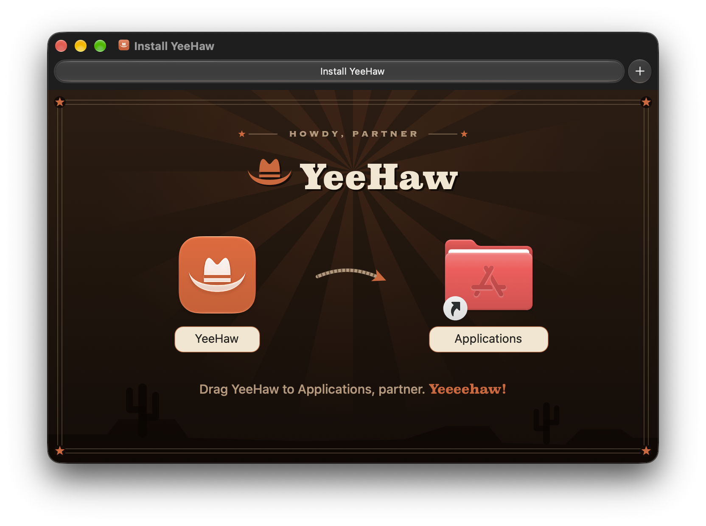

<p align="center">
  
</p>

<h1 align="center">YeeHaw</h1>

<p align="center">
  <strong>Round up your menu bar.</strong><br>
  A small, trustworthy menu bar manager for macOS 27.2 and later.
</p>

<p align="center">
  <a href="https://github.com/umzcio/YeeHaw/releases/latest"></a>
  
  
  
  <a href="LICENSE"></a>
</p>

YeeHaw hides the menu bar icons you don't need and keeps them one click away. It does three
things:

- **Hides icons.** Hidden icons leave the menu bar. Click YeeHaw's hat to open a strip just below
  the menu bar with the hidden icons in it. Clicking one works as if you had clicked it in the
  menu bar, and right-clicking gets its right-click menu.
- **Orders the icons that stay**, in the Layout window. Drag icons to reorder them, or between
  rows to hide and show them.
- **Adjusts the spacing between menu bar icons.** Change the layout and the spacing, then press
  Apply once for both. Apply restarts only the apps you pick.

It aims to be trustworthy above all:

- **The layout stays where you put it.** YeeHaw writes positions only when you change them.
- **Apple's switch wins.** An app you switched off in System Settings → Menu Bar never appears in
  YeeHaw, and YeeHaw never switches it back on.
- **Nothing is lost if YeeHaw quits or crashes.** Hidden icons go back to the menu bar on quit, and
  the next launch repairs anything a crash left behind. To put every icon back without opening
  YeeHaw (after a crash or a force quit), run
  `~/Applications/YeeHaw.app/Contents/MacOS/YeeHaw --restore`, or choose **Restore Everything and
  Quit** from the hat's menu.

## Install

1. Download `YeeHaw-<version>.dmg` from the [latest release](https://github.com/umzcio/YeeHaw/releases/latest).
2. Open it and drag YeeHaw to Applications, partner.
3. Open YeeHaw. A short first-run guide asks for the permissions below, one at a time.

<p align="center">
  
</p>

YeeHaw is signed with a Developer ID and notarized by Apple, so it opens without warnings.

### Updates

YeeHaw checks for a new version once a day and asks before installing it. Choose
**Check for Updates…** from the hat's menu to check now, or turn the daily check off in Settings.
Updates come from this repository's releases, through [Sparkle](https://sparkle-project.org), and
YeeHaw installs only an update signed with its own key.

## Using it

- **Click** the hat to open or close the strip of hidden icons. Esc closes it; the arrow keys and
  Return work in it, and every icon has a VoiceOver label.
- **Right-click** (or Control-click) the hat for **Layout…**, **Settings…**,
  **Check for Updates…**, **Restore Everything and Quit** and **Quit YeeHaw**.
- **Layout…** shows the menu bar and the Hidden row. Drag between them, or use each icon's
  actions. Spacing lives at the bottom of the same window.
- **Settings…** has Open at Login, updates, the permission statuses with buttons to fix a missing
  one, and the list of apps you switched off yourself.

## Requirements

- macOS 27.2 or later. YeeHaw shows a message and quits on anything older.
- A Mac where Thaw isn't running: both would write the same files, so YeeHaw won't start alongside
  it.

YeeHaw asks for what it needs in a short first-run guide:

| Permission | Why |
| --- | --- |
| **Accessibility** (called *Device Control and Data Access* on macOS 27) | To see which menu bar icons are drawn and where, and to click a hidden icon for you from the strip. |
| **Access to Apple's Allow list file** (`group.com.apple.controlcenter.plist`) | Hiding an icon is the same switch as System Settings → Menu Bar. You grant access once by choosing the file in an Open panel. |
| **Access to macOS's layout file** (`com.apple.MenuBar.plist`) | Ordering the visible icons writes their positions there. Granted the same way. |
| **Screen Recording** (optional) | Lets the strip show each app's real menu bar glyph and match the menu bar's colour. Without it, the strip shows app icons on a neutral background. YeeHaw never prompts for it; turn it on from Settings if you want it. |

YeeHaw isn't sandboxed: Accessibility, writing other apps' preference files and restarting apps
for spacing all need that.

## Building

You need Xcode 27.2 (Swift 6.2). The one dependency, [Sparkle](https://github.com/sparkle-project/Sparkle)
(updates), comes through Swift Package Manager.

```sh
swift test                         # unit tests (Swift Testing)
scripts/build-app.sh               # builds and signs dist/YeeHaw.app
scripts/build-app.sh --install     # also installs it to ~/Applications/YeeHaw.app
```

Development builds are always signed with team `V2P99VF75Q`'s certificate, never ad hoc, and run
from `~/Applications`. An ad-hoc rebuild would lose the Accessibility grant, and macOS won't list
apps that run from a temporary folder. `YEEHAW_SIGNING_IDENTITY` picks a different certificate
from the same team (its SHA-1 hash); `build-app.sh` refuses a build that isn't signed by team
`V2P99VF75Q`.

## Releasing

Bump `CFBundleShortVersionString` and `CFBundleVersion` in `Resources/Info.plist`, commit and push,
then:

```sh
scripts/release.sh --notes-file notes.md            # builds release/, prints the publish command
scripts/release.sh --notes-file notes.md --publish  # also tags vX.Y.Z and creates the GitHub release
```

The script:

1. Checks that YeeHaw's Sparkle key (login Keychain, account `com.zapps.yeehaw`) matches
   `SUPublicEDKey` in `Info.plist`. Installed copies refuse any update not signed with it.
2. Builds the app with team `V2P99VF75Q`'s Developer ID Application certificate and refuses to
   continue if the signature names any other team, or lacks the hardened runtime or a secure
   timestamp.
3. Notarizes the app with `xcrun notarytool submit --keychain-profile notary --wait`, staples it
   and checks that Gatekeeper reports `source=Notarized Developer ID`.
4. Makes `release/YeeHaw-<version>.dmg` with [create-dmg](https://github.com/create-dmg/create-dmg)
   (`brew install create-dmg`) over the background `scripts/render-dmg-background.swift` draws,
   then signs, notarizes and staples the DMG.
5. Writes `release/appcast.xml` with Sparkle's `generate_appcast`: the new version, the DMG as its
   download, its signature and the release notes.

With `--publish` it tags `v<version>` and creates the GitHub release with the DMG and
`appcast.xml`. Installed copies read `releases/latest/download/appcast.xml`, so they see the update
as soon as the release exists: within a day on their own, or at once from **Check for Updates…**.

Notary credentials live only in the `notary` Keychain profile, created once with
`xcrun notarytool store-credentials notary`; set `NOTARY_PROFILE` to use another profile. Never put
notary keys, passwords or the Sparkle private key in the repository.

## Project layout

- `Sources/YeeHawCore` — the model, with no AppKit: the position table, matching icons to apps,
  the hide/show/move rules and the crash-recovery journal.
- `Sources/YeeHaw` — the app: the status item, strip, Layout, Settings and first-run windows, and
  the system adapters (Accessibility, the two preference files, ScreenCaptureKit).
- `Tests` — Swift Testing suites for both targets.
- `scripts` — building, releasing, and drawing the installer's background.
- `docs/superpowers/specs` — the design.

## License

YeeHaw is released under the [MIT License](LICENSE). It includes
[Sparkle](https://github.com/sparkle-project/Sparkle), under Sparkle's own license (in the app as
`Contents/Resources/Sparkle-LICENSE.txt`).
